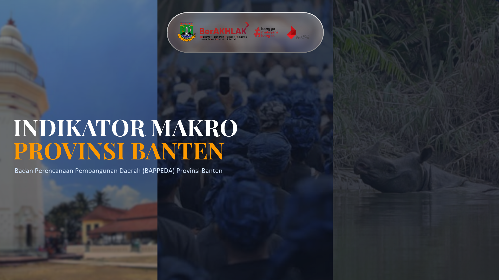
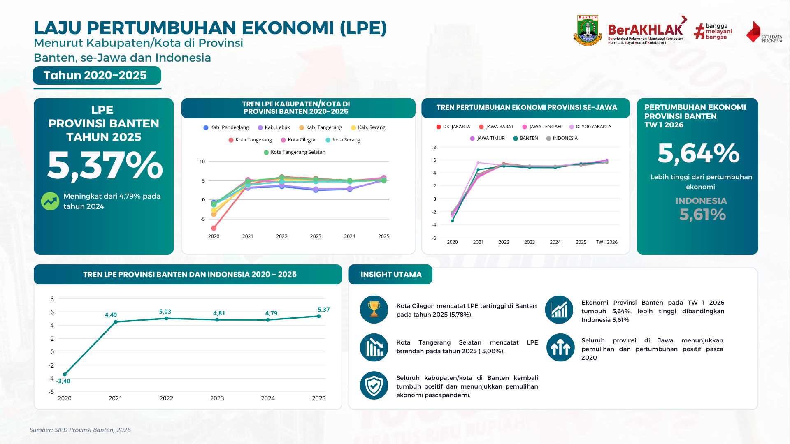
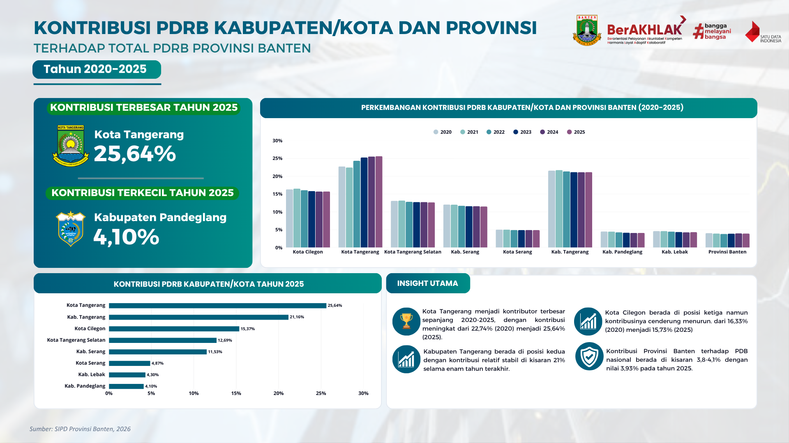
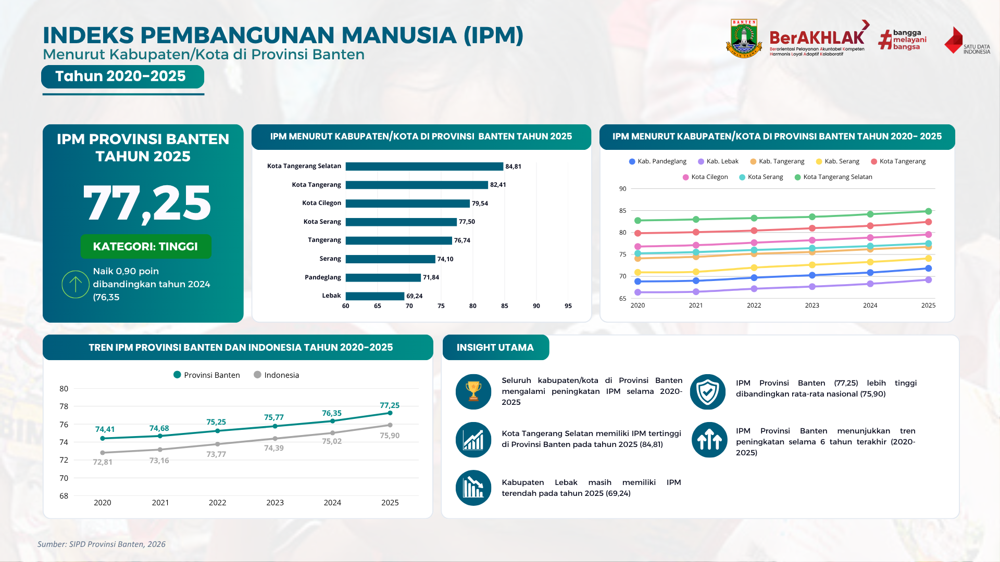
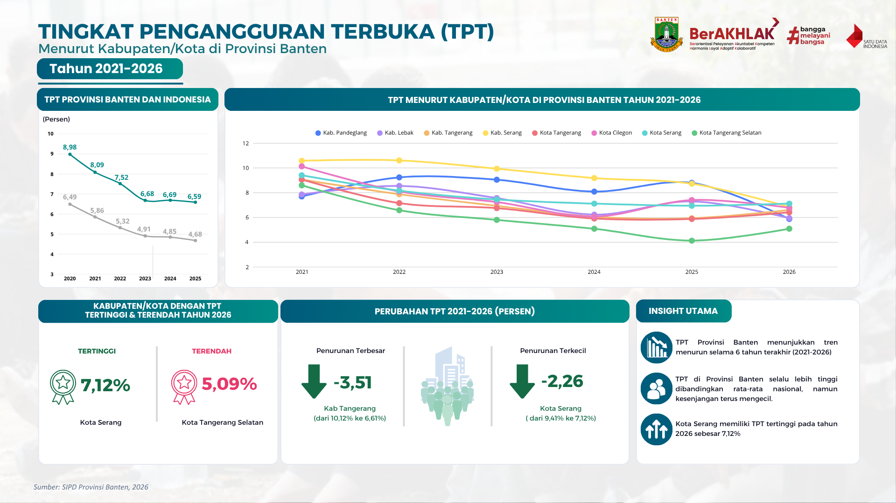
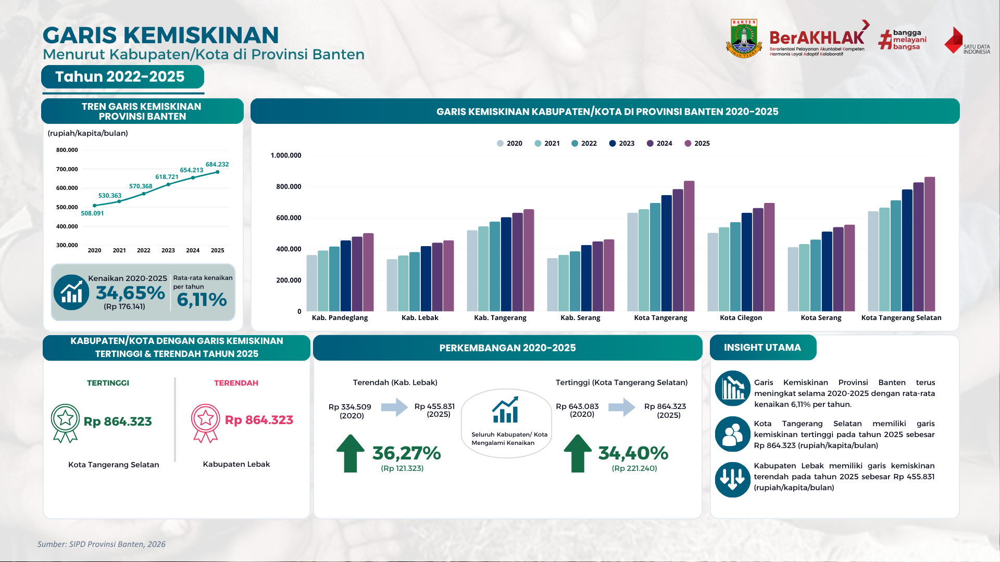
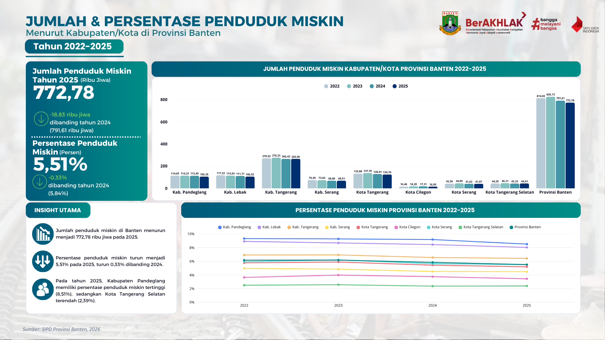
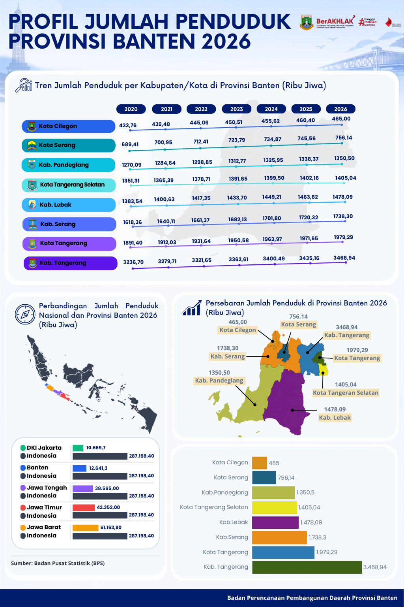
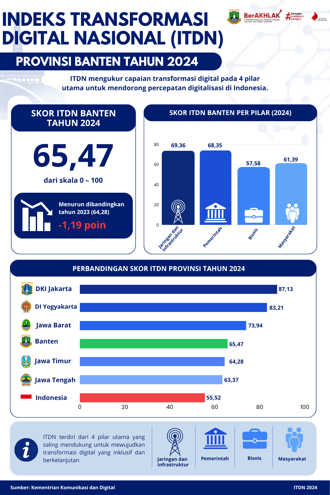

<div align="center">

# 📊 Infografis Indikator Makro Provinsi Banten
### Badan Perencanaan Pembangunan Daerah (BAPPEDA) Provinsi Banten

[](https://bappeda.bantenprov.go.id/)
[](./sumberData/README.md)
[](#-daftar-slide--topik-indikator)
[](#)

<br/>



<p align="center">
  <i>Visualisasi data indikator capaian pembangunan daerah, ekonomi makro, kependudukan, dan transformasi digital di Provinsi Banten.</i>
</p>

---

</div>

## 📌 Tentang Proyek

Repositori ini mendokumentasikan hasil visualisasi data dan infografis indikator makro pembangunan daerah yang disusun selama kegiatan **Magang di Badan Perencanaan Pembangunan Daerah (BAPPEDA) Provinsi Banten**. 

Visualisasi ini dirancang untuk menyajikan data statistik sektoral dan indikator kinerja utama pembangunan daerah secara komunikatif, berbasis data (*data-driven*), dan mudah dipahami oleh perencana pembangunan, pimpinan daerah, serta masyarakat umum.

---

## 🧭 Struktur Repositori

```text
├── Infografis/                  # Kumpulan gambar slide infografis beresolusi tinggi (1.png - 21.png)
│   ├── 1.png                    # Cover infografis
│   ├── 2.png                    # Laju Pertumbuhan Ekonomi (LPE)
│   └── ...
├── sumberData/                  # Dokumentasi metodologi, katalog, dan tautan rujukan resmi
│   └── README.md                # Tabel komprehensif sumber rujukan per slide
└── README.md                    # Halaman utama repositori
```

---

## 📈 Daftar Slide & Topik Indikator

Secara garis besar, 21 slide infografis dikelompokkan ke dalam 4 pilar indikator:

### 1. Perekonomian & Pertumbuhan Regional
* **Slide 02**: Laju Pertumbuhan Ekonomi (LPE) Menurut Kab/Kota, se-Jawa, dan Nasional (2020–2025)
* **Slide 03**: Kontribusi PDRB Kabupaten/Kota terhadap Total PDRB Provinsi Banten (2020–2025)
* **Slide 04**: PDRB Per Kapita Atas Dasar Harga Berlaku (ADHB) (2020–2025)
* **Slide 05**: PDRB Per Kapita Atas Dasar Harga Konstan (ADHK) (2020–2025)

### 2. Kesejahteraan Sosial, Kemiskinan & Ketenagakerjaan
* **Slide 06**: Indeks Pembangunan Manusia (IPM) Menurut Kab/Kota di Banten (2020–2025)
* **Slide 07**: Tingkat Pengangguran Terbuka (TPT) Kabupaten/Kota (2021–2026)
* **Slide 08**: Garis Kemiskinan Menurut Kabupaten/Kota (2022–2025)
* **Slide 09**: Jumlah & Persentase Penduduk Miskin Kabupaten/Kota (2022–2025)
* **Slide 10**: Perkembangan Ketimpangan Pendapatan / Gini Ratio (2020–2025)

### 3. Ketahanan, Perumahan & Pembangunan Manusia
* **Slide 11**: Indeks Risiko Bencana Indonesia (IRBI) Kabupaten/Kota (2019–2025)
* **Slide 12**: Persentase Rumah Tangga dengan Akses Air Minum Layak (2020–2025)
* **Slide 13**: Prevalensi Ketidakcukupan Konsumsi Pangan / Prevalence of Undernourishment (2021–2025)
* **Slide 14**: Indeks Pembangunan Keluarga (iBANGGA) (2021–2025)
* **Slide 15**: Indeks Pembangunan Pemuda (IPP) (2020–2024)
* **Slide 16**: Profil dan Persebaran Proyeksi Jumlah Penduduk Provinsi Banten Tahun 2026
* **Slide 21**: Rata-rata Lama Sekolah (RLS) Penduduk Usia 15 Tahun ke Atas (2020–2025)

### 4. Transformasi Digital Nasional (ITDN)
* **Slide 17**: Skor Indeks Transformasi Digital Nasional (ITDN) Provinsi Banten Tahun 2022
* **Slide 18**: Skor Indeks Transformasi Digital Nasional (ITDN) Provinsi Banten Tahun 2024
* **Slide 19**: Capaian Longitudinal ITDN 2018–2022 (Kerangka 5 Pilar)
* **Slide 20**: Capaian Longitudinal ITDN 2023–2024 (Kerangka 4 Pilar)

---

## 🖼️ Preview Slide Infografis

<details>
<summary><b>🔍 Klik di sini untuk melihat pratinjau slide utama</b></summary>

<br/>

### Laju Pertumbuhan Ekonomi (Slide 02)


### Kontribusi PDRB Kabupaten/Kota (Slide 03)


### Indeks Pembangunan Manusia (Slide 06)


### Tingkat Pengangguran Terbuka (Slide 07)


### Kemiskinan & Garis Kemiskinan (Slide 08 & 09)

<br/><br/>


### Profil Jumlah Penduduk Banten 2026 (Slide 16)


### Transformasi Digital Nasional / ITDN (Slide 18)


</details>

---

## 🔗 Rujukan Data Resmi

Seluruh data numerik yang ditampilkan dalam slide infografis diambil dari sumber data sekunder yang sah dan terverifikasi:
* **Badan Pusat Statistik (BPS Provinsi Banten & BPS RI)**
* **Sistem Informasi Pembangunan Daerah (SIPD Provinsi Banten / Kemendagri)**
* **Badan Nasional Penanggulangan Bencana (InaRISK BNPB)**
* **Kementerian Komunikasi dan Digital (Komdigi) & LPEM FEB UI**
* **Badan Kependudukan dan Keluarga Berencana Nasional (BKKBN)**
* **Kementerian Pemuda dan Olahraga (Kemenpora)**

> [!NOTE]  
> Untuk rincian tautan publikasi per indikator, tabel referensi, dan catatan teknis, silakan lihat langsung di [**sumberData/README.md**](./sumberData/README.md).

---

## 👤 Penyusun & Kontribusi

* **Program**: Kegiatan Magang Mandiri / MBKM di Bappeda Provinsi Banten
* **Fokus**: Analisis Data Makro & Desain Komunikasi Visual Perencanaan Pembangunan Daerah

---
<p align="center">
  Dibuat dengan dedikasi untuk mendukung keterbukaan data dan perencanaan pembangunan Provinsi Banten yang lebih baik.
</p>
